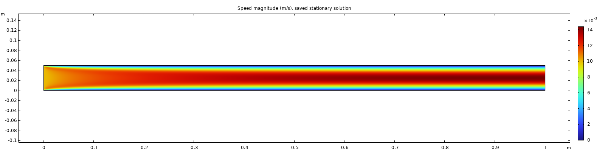
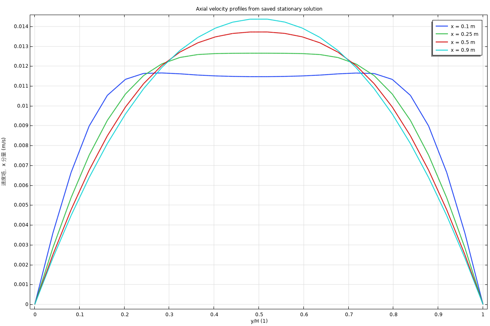

# 基准保存解的速度场复核材料

日期：2026-10-11；COMSOL 6.3.0.290。

本轮从已提交基准模型的保存解导出速度云图、四个截面的轴向速度曲线和原始采样数据。没有重新求解，也没有保存原始基准模型。工程检查通过，GUI 查看与专业人员审核仍待完成。

## 速度云图



图由 COMSOL 原生图组导出，保持管道 20:1 的几何长宽比。色标为速度大小（m/s），显示入口发展区、近壁低速及下游中心区域速度升高。

## 截面速度



截面位于 x=0.1、0.25、0.5、0.9 m。横轴为 y/H，纵轴为轴向速度 u（m/s）。近入口的截面尚未呈现充分发展的抛物线形状，不能据此宣称全管道都是充分发展流动。

| x（m） | 中心 u（m/s） | 截面上下壁采样速度最大值（m/s） | 对称性相对误差 |
|---:|---:|---:|---:|
| 0.1 | 0.0114704884 | 8.01e-19 | 0.0444% |
| 0.25 | 0.0126508408 | 3.16e-19 | 0.0226% |
| 0.5 | 0.0137198910 | 5.57e-19 | 0.00937% |
| 0.9 | 0.0143652452 | 0 | 0.0118% |

每个截面采样 101 点。对称性指标为镜像采样 u 的最大差值除以该截面的最大绝对 u；1% 仅为工程筛查阈值，不代替网格无关性或物理准确性验收。

## 定量核对与来源

- 最大速度：0.0144265456 m/s。
- 入口/出口质量流量：0.4875000000 / 0.4870954446 kg/(m·s)。
- 相对质量误差：8.29857166e-4，小于当前 1e-3 阈值。
- 壁面内部速度及最小轴向速度：均为 0 m/s。
- 压降：0.0775840421 Pa。
- 六个指标与原始求解记录逐项一致，比较容差为相对 1e-8、绝对 1e-12。

源模型 SHA-256：`023D94CF9C7F2DD5B5BF1BD581B1F19AB8A38CF9304C3AF25F239A2398707E1B`。

版本化证据：[复核摘要](../data/fixtures/baseline_review.json)、[原始截面采样](../data/fixtures/baseline_review_samples.json)、[原始求解记录](../data/fixtures/baseline_verification.json)。图片与两份复核 JSON 来自同一次真实导出；离线测试会重新计算摘要并检查图片尺寸。

二维质量流量为单位出平面厚度的流量。入口实际积分比理想均匀入口的 0.5 kg/(m·s) 低，交角约束及网格影响仍需专业复核；详见 [基准模型规范](BASELINE_MODEL.md)。

## 重新生成

在仓库根目录运行，`<COMSOL_ROOT>` 为包含 `bin/win64` 的 Multiphysics 目录：

```powershell
python src/flowpilot/review_baseline.py --comsol-root '<COMSOL_ROOT>' --output-dir outputs/baseline-review/review-001 --timeout 300
```

仅接受 SHA-256 与 manifest 中已提交基准一致的模型。需要使用另一个路径下的同一文件时可传入 `--model`；有本地未提交修改的模型会被拒绝。每次必须指定新的输出目录。

输出包含 `velocity.png`、`profiles.png`、`field_samples.json`、`review.json`、`report.md`、运行记录和本地 `baseline_with_review_plots.mph`。复核副本保留保存解，并增加 `fp_velocity`、`fp_profiles` 图组，可在 COMSOL 中打开查看；不要将其覆盖到原始基准。

新增入口使用现有的进程超时、模型副本及哈希保护机制。图像导出通过 COMSOL 的 `-graphics -3drend sw` 软件渲染完成，不新增 Python 绘图依赖。仅在图像、复核副本及唯一完成标记全部存在且校验通过后发布复核报告；`run.json.status` 必须为 `completed`。

复核副本仅保留在忽略的 `outputs/` 目录中。团队共享可使用本页图片与版本化采样；若需要共享复核 `.mph`，另行按 Git LFS 流程处理。原始六个模型的哈希应始终与 manifest 匹配。

## 专业审核记录

- [ ] 在 COMSOL 中打开复核副本，确认图组、数据集及保存解来源。
- [ ] 审核入口发展区、截面形状、壁面条件和速度范围。
- [ ] 审核离散入口流量偏差、质量守恒阈值及网格影响。
- [ ] 填写审核人、日期、结论和剩余问题。

当前记录中的 `expert_review_pending` 不会因工程检查通过自动变更。五个异常模型未在本轮求解，基准图片不能代替异常模型的结果或标签审核。

## 验证、影响与回退

真实验证包括从保存解导出、与历史指标对照、检查图片和复核副本、复查原模型哈希。离线测试覆盖数据形状、非有限值、指标漂移、反向速度、坏壁面、对称性、缺失图片及模型保护；模拟的导出不能代替真实 COMSOL 验证。

本轮只增加复核入口与小型证据文件，不修改现有模型和诊断契约。撤回 `review_baseline.py`、`BaselineReview.java` 及本轮材料即可回退，原检查入口仍可使用。

API 依据：[Interp](https://doc.comsol.com/6.3/doc/com.comsol.help.comsol/comsol_api_results.52.075.html)、[Image export](https://doc.comsol.com/6.3/doc/com.comsol.help.comsol/comsol_api_results.52.070.html)、[LineGraph](https://doc.comsol.com/6.3/doc/com.comsol.help.comsol/comsol_api_results.52.088.html)。
